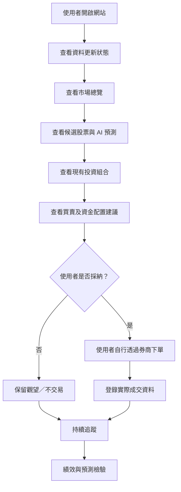

# 台股智慧量化投資決策系統｜產品企劃書

- 文件版本：0.2（初步產品提案＋目前進度）
- 日期：2026-11-14（提案）；2026-11-21 更新目前進度（§13）與待決策事項（§10）
- 產品暫定名稱：台股智慧量化投資決策系統
- 產品型態：個人使用的跨裝置投資分析網站
- 狀態：網站與每日自動化已上線，選股模型未通過驗證、以參考方式顯示，模擬運作中

---

## 1. 產品概念

### 1.1 產品願景

打造一套能夠持續研究台股、分析市場、預測個股風險與報酬，並提供投資組合建議的智慧量化投資工具。

使用者不需要每天自行翻查大量股票與指標。系統在每個交易日收盤後自動更新資料、執行分析，最後提供一份可理解、可驗證、可追蹤的投資決策報告。

### 1.2 核心價值

**不是讓 AI 猜哪支股票會漲，而是建立一套能用資料證明投資決策是否有優勢的系統。**

產品以三個能力為核心：

1. **量化分析：** 將市場與個股資訊轉成可測量的因子及策略訊號。
2. **機器學習：** 從歷史資料學習報酬、風險與個股相對表現。
3. **投資組合管理：** 將分析結果轉換成考慮資金、成本與風險的行動建議。

### 1.3 產品目標

- 在可接受的風險限制下追求資產複利成長。
- 讓選股與交易決策可量化、可回測、可驗證、可優化。
- 降低人工掃描全市場及整理資料的時間。
- 讓使用者知道每項建議的理由、風險及模型依據。
- 讓系統能持續記錄預測與實際結果，檢驗模型是否真的有用。

不承諾特定獲利、勝率或資產成長速度。

---

## 2. 目標使用情境與使用者

### 2.1 主要使用者

第一階段以單一個人使用者為主，具備基本股票投資經驗，希望以中期波段方式管理資產，並透過程式與模型輔助決策。

### 2.2 已確認的使用需求

| 項目 | 需求 |
|---|---|
| 市場 | 台灣上市、上櫃股票 |
| 選股 | 全市場掃描 |
| 投資週期 | 20／60／120 個交易日，以 60 日為核心 |
| 風險取向 | 平衡型 |
| 分析時間 | 每日收盤後 |
| 決策方式 | 系統提供建議，使用者自行下單 |
| 報告 | 完整投資組合報告 |
| 裝置 | 電腦與手機均可透過網站使用 |

### 2.3 典型使用情境

1. 使用者在手機或電腦開啟網站。
2. 查看最新資料日期與市場狀態。
3. 檢視系統篩選出的候選股票。
4. 查看 20／60／120 日預測、策略理由及風險。
5. 查看目前持股與現金配置。
6. 閱讀系統建議的買進、持有、減碼、賣出或觀望清單。
7. 使用者自行決定是否下單。
8. 回到系統登錄實際成交，讓系統追蹤績效。

### 2.4 使用者目標（2026-11-19 確認）

- 想要的是 **1～2 個月（波段）內會上漲、能讓資產成長的股票**，不是長期持有 0050。
- **跌得比較少比贏過 0050 更重要**：回撤目標 −25%，必要時可到 −30%。
- 使用者不是投資專業人士：網站要先給結論、用圖示表達，名詞與計算方式收在「看細節」裡。

---

## 3. 產品核心功能

### 3.1 市場總覽

顯示：

- 加權指數及櫃買指數市場狀態。
- 市場趨勢、波動及廣度。
- 產業強弱與輪動。
- 當日資料更新時間。
- 市場風險提示。

### 3.2 全市場選股分析

對上市櫃股票進行分析，並依流動性、交易限制及資料完整性進行必要篩選。

分析面向：

- 趨勢與動能。
- 個股相對大盤及產業強度。
- 成交量與成交金額。
- 波動度與下行風險。
- 法人及融資融券等籌碼。
- 營收、獲利及財務品質。

### 3.3 量化策略研究

不預先認定某種策略最好，獨立研究：

- 趨勢成長型。
- 強勢輪動型。
- 成長潛力型。
- 風險調整型。
- 短期反轉及過度延伸風險。

每個策略都需要獨立回測、成本評估及樣本外驗證。

### 3.4 AI 預測

以多模型方式預測：

- 20 日報酬及風險。
- 60 日報酬及風險。
- 120 日報酬及風險。
- 正報酬機率。
- 相對大盤或產業的預期表現。

候選模型包含 LightGBM、XGBoost、統計模型及市場狀態模型。是否採用特定模型，依實際驗證結果決定。

### 3.5 策略與 AI 融合

量化策略與 AI 各自提供預測及訊號，再由融合層整合。

產品必須能解釋：

- 哪些策略看好這檔股票。
- AI 預測是否支持量化訊號。
- 是否有模型意見衝突。
- 預期報酬與風險如何。
- 為何最終列入或排除候選名單。

### 3.6 投資組合管理

- 記錄現金及持股。
- 追蹤持股損益。
- 計算建議部位與股數。
- 評估產業集中度及個股相關性。
- 評估交易成本及換股效益。
- 提供買進、持有、減碼、賣出及觀望建議。

### 3.7 每日投資報告

報告內容：

1. 市場環境。
2. 候選股票排名。
3. 多週期報酬與風險預測。
4. 量化與 AI 訊號整合結果。
5. 現有持股狀態。
6. 建議交易及股數。
7. 資金與風險檢查。
8. 模型健康狀態與資料異常提醒。

### 3.8 績效與模型追蹤

- 每筆交易的成交與成本紀錄。
- 策略與模型預測紀錄。
- 預測與實際報酬比較。
- 投資組合績效與最大回撤。
- 模型版本與更新紀錄。
- 策略失效及模型漂移警示。

---

## 4. 產品操作流程

---

## 5. 網站與跨裝置使用規劃

### 5.1 使用方式

產品採網站形式，使用者透過網址即可開啟，不要求在每台裝置安裝桌面程式。

介面需支援：

- 桌面電腦：完整市場分析、表格、圖表及投資組合管理。
- 手機：重點摘要、候選股票、持股狀態及交易建議。
- 平板：介於兩者之間的自適應版面。

後續可評估 PWA，讓使用者可將網站加入手機主畫面。PWA 不等於原生券商交易 App，也不代表可以在背景無限制執行資料分析。

### 5.2 GitHub 的角色

建議採用「GitHub 管理程式碼＋前端網站託管＋獨立後端資料服務」的方式。

| 部分 | 建議角色 |
|---|---|
| GitHub Repository | 程式碼、文件、版本管理 |
| GitHub Pages | 可選擇用來發布靜態前端 |
| 後端 API | 提供資料查詢、報告與使用者資料服務 |
| 排程服務 | 每個交易日更新資料及執行分析 |
| 資料庫 | 保存歷史行情、因子、模型預測、交易紀錄 |
| 模型執行環境 | 執行量化策略及機器學習模型 |

GitHub Pages 適合靜態網站，不支援在 Pages 主機直接執行 Python 等伺服器端程式。因此，不應把 API 金鑰、資料庫密碼或完整資料擷取程式放在公開前端。

GitHub Actions 可用於測試、部署及部分排程工作，但排程工作可能延遲，不宜未經評估就作為唯一的每日金融資料更新服務。

### 5.3 每日資料新鮮度

第一階段定義為：

**交易日收盤後取得當日最新可用資料，完成分析後更新網站報告。**

網站必須清楚顯示：

- 最新行情日期。
- 最後成功更新時間。
- 各資料類別的更新狀態。
- 分析完成時間。
- 若資料延遲，明確標示延遲日期。

不能將前一交易日資料顯示成當日資料。

盤中即時行情是未來可擴充功能，需另行評估供應商授權、費用、API 頻率及即時系統架構。

---

## 6. 產品差異化

本產品不以「AI 推薦股票」作為唯一賣點，而是強調完整的可驗證決策流程。

| 一般選股工具常見做法 | 本產品規劃 |
|---|---|
| 以指標條件篩選 | 多策略獨立研究與比較 |
| 只提供漲跌訊號 | 提供報酬、風險及機率預測 |
| 只看個股 | 同時分析市場與投資組合 |
| 不一定揭露模型依據 | 保留策略、模型及資料版本 |
| 只看歷史績效 | 重視樣本外及 Walk-forward 驗證 |
| 只推薦股票 | 同時計算資金、成本及風險 |
| 模型更新不透明 | 定期訓練、驗證通過才升級 |

---

## 7. 風險與限制

### 7.1 投資風險

- 模型預測不代表未來結果。
- 市場結構可能改變，歷史規律可能失效。
- 高勝率不等於高報酬或低風險。
- 回測結果可能受到過度擬合影響。
- 小額本金容易受到最低手續費及交易成本影響。
- 全市場掃描不代表所有股票都具備足夠流動性。

### 7.2 資料風險

- 免費資料來源可能限流、延遲或變更。
- 不同來源的欄位與調整方式可能不一致。
- 財報及營收公告時間必須正確處理。
- 資料供應商的使用授權可能限制儲存、展示或再散布。

### 7.3 技術風險

- 靜態網站不能取代後端運算環境。
- 前端不得暴露 API 金鑰。
- 排程服務可能失敗，需有錯誤紀錄與重試機制。
- 模型運算與歷史資料量可能提高主機及儲存成本。
- 網站必須顯示資料更新狀態，避免使用者誤信過期報告。

---

## 8. 開發路線圖

### Phase 1｜資料與回測基礎

目標：先建立可信任的研究環境。

- 確認資料供應商及授權。
- 建立行情與基本資料資料庫。
- 完成資料品質檢查。
- 建立交易成本及成交模擬。
- 建立基準策略與回測框架。

### Phase 2｜量化策略研究

目標：確認不同交易邏輯是否具有統計優勢。

- 趨勢策略。
- 強勢輪動策略。
- 成長潛力策略。
- 風險調整策略。
- 比較不同市場環境下的結果。

### Phase 3｜機器學習研究

目標：驗證 AI 是否能帶來額外預測價值。

- 定義 20／60／120 日預測目標。
- 建立特徵工程。
- 訓練候選模型。
- 機率校準及風險預測。
- 執行樣本外與 Walk-forward 驗證。

### Phase 4｜策略融合與投資組合

目標：將已驗證策略轉換為投資建議。

- 策略融合。
- AI 預測整合。
- 持股與現金管理。
- 部位及風險計算。
- 買賣訊號與決策理由。

### Phase 5｜網站與每日自動化

目標：讓使用者透過電腦與手機查看報告。

- 前端網站。
- 後端 API。
- 資料庫。
- 每日排程。
- 每日投資報告。
- 手機響應式介面。

### Phase 6｜模擬運作與正式使用

目標：驗證系統在真實時間環境的表現。

- 以最新資料每日產生訊號。
- 記錄但不立即依賴真實資金執行。
- 比較預測與實際結果。
- 觀察模型漂移與策略失效。
- 達到預先定義的驗收標準後，再作為實際投資輔助工具。

---

## 9. 成功衡量指標

產品成功不能只用網站是否完成或 AI 是否能輸出股票名稱衡量。

### 投資研究指標

- 成本後 CAGR。
- 最大回撤。
- Sharpe／Sortino。
- 相對大盤超額報酬。
- 樣本外績效。
- 不同市場狀態下的穩健性。
- 模型相較於量化基準的增量價值。

### 產品運作指標

- 每日資料更新成功率。
- 資料延遲及錯誤率。
- 每日分析完成率。
- 報告可用性。
- 模型版本可追溯性。
- 交易紀錄完整性。

正式驗收門檻需在取得資料及建立基準回測後制定，不在目前階段任意設定數字。

---

## 10. 待決策事項

1. 行情、財報、營收及籌碼資料供應商。（已決定：只用免費官方來源，不付費）
2. 免費與付費資料的成本及授權比較。（已決定：免費方案可行，見《資料來源評估.md》）
3. 前端、後端、資料庫與排程服務的正式選型。（已決定：GitHub Pages＋GitHub Actions，不設後端 API）
4. 是否需要使用者登入及雲端同步個人持股。（已決定：不登入、不同步；持股只存在瀏覽器或電腦，用 CSV 備份；候選股票用密碼加密）
5. 最大可接受回撤及風險預算。（已決定：回撤目標 −25%、上限 −30%；出場規則研究中）
6. 券商手續費折扣與零股交易規則。（已決定：最低手續費 1 元、會買零股；折扣可在網站上設定）
7. 模型訓練及更新週期。（研究每年一次；網站候選股票每天用最新已實現資料重新訓練；正式升級門檻待定）
8. 產品是否長期維持個人使用，或未來開放其他使用者。
9. 是否需要盤中即時資料。
10. 是否需要券商 API 或自動下單（目前不在第一階段範圍）。

---

## 11. 產品原則

1. 資產成長是目標，風險控制是必要條件。
2. 量化與 AI 都必須以資料驗證，不以技術新穎程度決定採用。
3. 不預設趨勢、輪動或成長潛力哪一種策略最好。
4. 沒有足夠優勢時，觀望是有效決策。
5. 每個建議都必須可解釋、可追溯。
6. 模型更新必須經過驗證，不可盲目自動替換。
7. 每日資料新鮮度必須透明。
8. 使用者始終保有最終交易決定權。

---

## 12. 參考資料

- GitHub Pages：What is GitHub Pages  
  https://docs.github.com/en/pages/getting-started-with-github-pages/what-is-github-pages
- GitHub Pages：Creating a GitHub Pages site  
  https://docs.github.com/en/pages/getting-started-with-github-pages/creating-a-github-pages-site
- GitHub Actions：Events that trigger workflows  
  https://docs.github.com/en/actions/reference/workflows-and-actions/events-that-trigger-workflows
- GitHub Pages limits  
  https://docs.github.com/en/pages/getting-started-with-github-pages/github-pages-limits

## 13. 目前進度（2026-11-21）

### 13.1 已上線的功能

網址：https://rein0325.github.io/apex/（電腦、手機皆可，可加到手機主畫面）。每個交易日晚上由 GitHub Actions 自動更新。

| 頁面 | 內容 | 對應功能 |
|---|---|---|
| 市場狀態 | 紅綠燈結論、建議股票占總資產比例、長期趨勢／漲跌幅度／轉強股票比例、櫃買市場、近一年走勢、產業強弱、資料更新狀態、模擬追蹤績效 | 3.1、3.7、5.3 |
| 候選股票（密碼） | 模型前 30 名；依投入金額配股；上漲機率、3 個月後價格區間、量化條件打勾、停損價、推薦理由；過去推薦的實際成績與策略失效警示 | 3.2、3.4、3.6、3.8 |
| 我的持股 | 記帳（只存在瀏覽器）、總資產與回撤、股票比例；每檔的結論標籤（該賣了／重新評估／續抱等）、出場線、模型看法、換股比較 | 3.6、3.8 |

電腦上另有 `apex daily` 每日報告與 `apex portfolio` 持股報告（《持股與每日報告.md》）。

### 13.2 和原本規劃不同的地方

| 原本規劃 | 實際做法 | 原因 |
|---|---|---|
| 候選股票必須通過驗證才提供 | 未通過驗證，但以「參考」方式顯示，附歷史統計與限制 | 使用者 2026-11-20 決定：買不買由自己判斷 |
| 前端＋後端 API＋資料庫 | 靜態網站＋每天產生的 JSON 檔，不設後端 API | 個人使用、免費、維護簡單 |
| 個股推薦公開在網站 | 用密碼加密後才放上公開網站 | 未持有投顧執照，不能公開推薦個股 |
| 策略與 AI 融合（Phase 4） | 尚未進行 | 沒有通過驗證的策略可以融合 |
| 本機測試 | 測試改在 GitHub Actions 執行 | 本機 Windows 安全設定會擋資料庫元件 |

### 13.3 驗證結果摘要

- 量化策略（Phase 2）：沒有策略在驗證期勝過 0050。
- 機器學習（Phase 3）：能把股票分出好壞（排除最差的股票最有效），但組成策略、扣掉成本後沒有通過驗證期。分數最高的等級，過去 60 個交易日後上漲比例約 56%，隨便挑約 48%。
- 實際追蹤：2026-11-20 起每天記錄推薦，第一批約在 2027 年 2 月底滿 60 個交易日；累積 50 筆到期推薦後才判斷模型準不準。

### 13.4 接下來

1. **出場規則研究**：停損、移動停損、依大盤減碼的回測，結果決定網站上的正式數字（《研究報告/出場規則研究.md》）。
2. **等待實際成績**：2027 年 2 月底起檢視推薦成績，約 2027 年 5 月做半年檢討，再決定正式使用的驗收標準與模型升級門檻。

> 本企劃為產品方向與初步規劃，不構成投資建議，也不保證系統未來績效。資料供應、策略有效性及模型預測能力均須經後續研究與測試確認。
