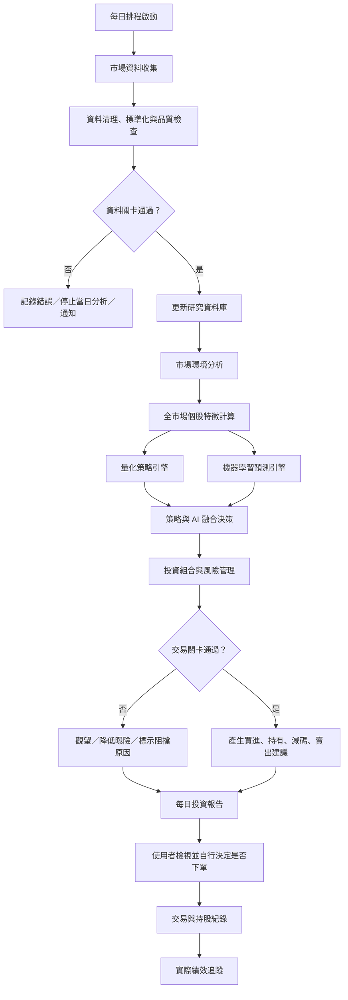
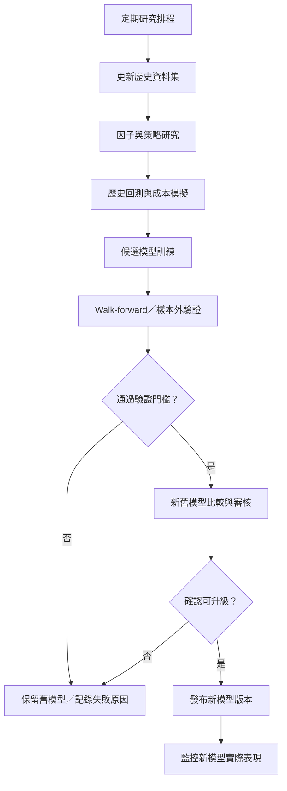
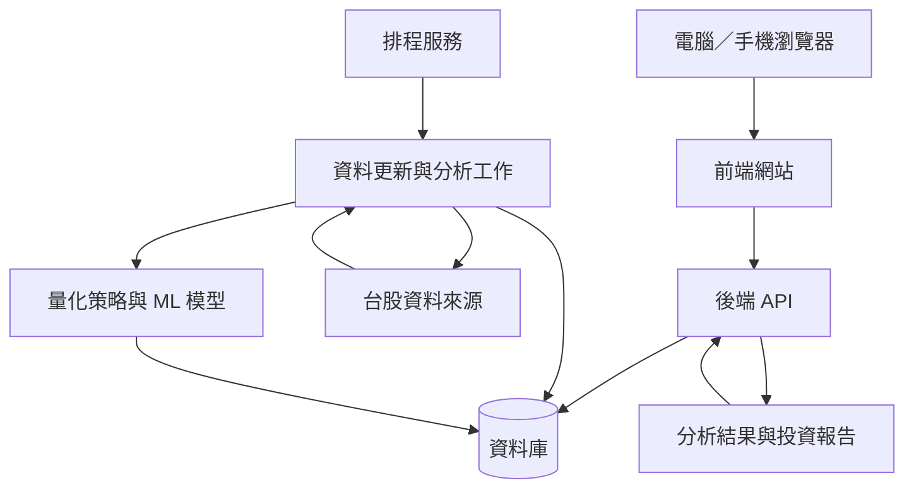

# 台股智慧量化投資決策系統｜系統規格書

- 文件版本：0.2（流程基線＋實作現況）
- 日期：2026-11-14（基線）；2026-11-21 更新實作現況（§11）與待決事項（§8）
- 狀態：Phase 1～3 研究完成；網站、每日自動化與持股管理已上線；模擬運作中
- 文件目的：作為後續 AI 工程師、開發者與產品設計的共同依據，避免實作偏離已確認的系統流程。

---

## 1. 系統概述

### 1.1 系統定位

建立一套以台灣上市、上櫃股票為分析範圍，結合量化交易策略與機器學習的投資決策系統。系統每日收盤後取得可用的最新市場資料，分析市場狀態與個股，產生多週期報酬及風險預測，整合策略結果後提供投資組合建議。

系統的最終目標為：**在明確風險限制下，追求資產複利成長**。

系統第一階段以投資建議為主，由使用者自行確認並下單，不自動執行交易。

### 1.2 已確認的產品決策

| 項目 | 已確認內容 |
|---|---|
| 市場範圍 | 台股上市＋上櫃 |
| 選股範圍 | 全市場掃描，另設流動性及可交易性篩選 |
| 分析頻率 | 每個交易日收盤後 |
| 預測週期 | 20、60、120 個交易日 |
| 主要週期 | 60 個交易日（2026-11-21 起研究「2～5 個月內大漲 30%」，見 §8 第 5 項） |
| 風險取向 | 平衡型：主要資金 0050 保底，額外資金 10～20% 選股（2026-11-21） |
| 核心績效目標 | 風險限制下的資產複利成長 |
| 策略架構 | 量化策略與機器學習雙引擎融合（Ensemble） |
| 使用方式 | 系統提供建議，使用者自行確認下單 |
| 模型更新 | 定期重新訓練；驗證通過才可替換正式模型 |
| 每日輸出 | 完整投資組合決策報告 |
| 策略研究 | 趨勢成長、強勢輪動、成長潛力三類策略均獨立驗證，不預設優勝者 |
| 裝置 | 電腦與手機瀏覽器皆可使用，採響應式網站設計 |

### 1.3 非目標（第一階段不做）

- 不進行盤中高頻交易。
- 不自動連接券商下單。
- 不保證獲利、勝率或特定報酬。
- 不因 AI 模型輸出高分就直接下單。
- 不以生成式 AI 的自然語言判斷取代可重複執行的量化計算。
- 不在尚未驗證前，將任何策略或模型標示為有效策略。

> 2026-11-20 使用者決定：模型雖未通過驗證，仍在網站上顯示候選股票作為參考，但必須標示「未通過驗證」、附上歷史統計與限制，且不得稱為有效策略（見《候選股票.md》）。

---

## 2. 系統總體流程

系統另有獨立的定期研究與模型更新流程：

---

## 3. 每日運作流程規格

### STEP 01｜市場資料收集

**目的：** 取得台股分析所需的原始資料。

預計資料類別：

- 上市、上櫃股票日 OHLCV（開、高、低、收、成交量）。
- 成交金額、成交筆數及流動性資料。
- 加權指數、櫃買指數及其他市場基準。
- 產業分類與個股所屬產業。
- 三大法人買賣超等籌碼資料。
- 融資融券等市場資料。
- 月營收、財務報表及公告時間。
- 除權息、分割、合併、停牌、下市及交易限制等事件資料。

**必要規則：**

1. 每筆資料必須保留來源、取得時間、資料所屬日期及更新時間。
2. 區分「資料日期」與「資料實際可取得時間」。
3. 財報、營收等資料只能在實際公告後供模型使用，禁止前視偏誤。
4. 資料來源、授權、API 使用限制及商用條款須在正式選定前確認。
5. 不假設任何免費資料來源可永久、穩定或合法支援全部需求。

**輸出：** 原始資料及資料更新紀錄。

### STEP 02｜資料清理與資料庫更新

**目的：** 確保資料一致、可追溯且適合研究。

工作項目：

- 欄位與格式標準化。
- 缺漏值、重複資料、異常值檢查。
- 股票代碼與公司事件對照。
- 股價還原及除權息處理。
- 交易日曆與非交易日處理。
- 資料版本及來源紀錄。
- 歷史下市股票納入研究資料，降低倖存者偏差。

**資料品質關卡：**

若關鍵行情資料缺漏、日期不一致、來源失敗或資料異常，當日流程不得默默使用不完整資料產生買進建議。應標示資料狀態，必要時停止分析。

**輸出：** 經驗證的標準化資料集。

### STEP 03｜市場環境分析

**目的：** 判斷當前市場環境，作為策略啟用與風險曝險的依據。

候選分析面向：

- 大盤及櫃買指數趨勢。
- 市場廣度與上漲／下跌家數。
- 市場整體波動度。
- 成交金額與市場活躍程度。
- 產業強弱及輪動狀況。
- 市場狀態模型（例如 HMM）與傳統規則的比較。

候選市場狀態：

- 多頭趨勢
- 空頭趨勢
- 盤整
- 高波動／風險升高
- 狀態不明或資料不足

市場狀態不直接等於買賣訊號，而是用於調整策略適用性、交易門檻及整體曝險。

**輸出：** 市場狀態、狀態信心及風險提示。

### STEP 04｜全市場個股分析與特徵工程

**目的：** 對符合基本交易條件的上市櫃股票計算模型及策略所需特徵。

候選特徵：

- 趨勢：不同期間均線、價格趨勢與趨勢斜率。
- 動能：20／60／120 日報酬及其他形成期間。
- 相對強度：相對大盤、相對產業排名。
- 價量：成交量變化、成交金額、量價關係。
- 波動與風險：歷史波動、下行波動、跳空與回撤特徵。
- 籌碼：法人買賣超、融資融券變化。
- 基本面：營收成長、獲利能力、財務品質。
- 可交易性：成交金額、流動性、交易限制與價格條件。

特徵必須遵守資料可取得時間，不得使用當時尚未公開的資訊。

**輸出：** 每檔股票、每個交易日對應的特徵資料。

### STEP 05A｜量化策略引擎

**目的：** 以明確、可解釋、可重複的規則測試不同投資邏輯。

候選策略研究方向：

1. 趨勢成長型：尋找中長期趨勢延續的股票。
2. 強勢輪動型：比較全市場與產業內相對強度，研究強勢股持續性。
3. 成長潛力型：研究基本面改善及市場尚未充分反映的訊號。
4. 風險調整策略：研究波動度調整、部位縮放及下行風險控制。
5. 短期反轉／過度延伸：作為對照策略或進場風險濾網。

**研究原則：**

- 各策略先獨立回測，再測試組合。
- 不預先指定哪種策略必定最好。
- 每個策略必須納入交易成本、滑價及可交易性限制。
- 比較策略對不同市場狀態的敏感度。
- 只有通過驗證的策略才可進入正式融合決策。

**輸出：** 策略訊號、候選股票、策略分數、適用條件及策略版本。

### STEP 05B｜機器學習預測引擎

**目的：** 估計未來不同持有期間的報酬與風險，補足傳統規則的非線性及特徵交互分析能力。

預測週期：

- 20 個交易日：短期輔助。
- 60 個交易日：主要決策週期。
- 120 個交易日：中長期輔助。

候選預測任務：

- 未來報酬估計。
- 正報酬機率。
- 相對大盤／產業超額報酬。
- 波動度與下行風險。
- 個股橫斷面排名。

候選模型（須以實驗決定是否保留）：

- LightGBM、XGBoost：結構化資料預測。
- Logistic Regression：機率預測基準。
- HMM：市場狀態辨識候選。
- GARCH 類模型：波動度預測基準。
- 其他時序深度學習模型：後續比較，不預設優於樹模型。

**模型輸出至少應包含：**

- 預測期間。
- 預期報酬或報酬分布。
- 正報酬機率及校準狀態。
- 相對報酬預測。
- 風險預測。
- 模型版本與資料截止時間。
- 預測信心或適用性警示。

不得將模型輸出解讀為保證報酬。若模型校準不佳、資料異常或超出訓練適用範圍，必須降低其影響或停用。

### STEP 06｜量化策略與 AI 融合決策

**目的：** 將不同策略及模型的獨立結果整合成一致的投資判斷。

融合原則：

1. 先確認各策略／模型是否通過驗證及當日資料品質檢查。
2. 比較策略訊號與 AI 預測方向。
3. 評估預期報酬、下行風險、交易成本及市場狀態。
4. 標示策略與模型意見一致或衝突。
5. 依經驗證的融合方法產生綜合排名。
6. 不允許單一模型高分推翻硬性風險限制。

融合方法可比較規則式投票、標準化加權、預測堆疊（stacking）等方式；權重必須由訓練與驗證資料決定，不可任意指定。

**輸出：** 綜合排名、建議方向、理由、風險及訊號衝突標記。

### STEP 07｜投資組合與風險管理

**目的：** 將股票排名轉換成符合使用者資金及風險限制的投資組合建議。

必要輸入：

- 使用者可投入資金及現金。
- 現有持股、成本、股數及交易紀錄。
- 股票預期報酬及風險。
- 股票間相關性。
- 交易成本、最低手續費及交易稅。
- 零股／整股交易條件。
- 流動性與交易限制。

必要功能：

- 建議買進、持有、減碼、賣出或觀望。
- 建議部位與股數計算。
- 單一持股與整體投資組合風險控制。
- 產業集中度及相關性檢查。
- 現金保留及換股成本評估。
- 最大回撤及風險限制監控。

本金規模較小，必須特別評估最低手續費與零股交易成本；不得直接套用大型投資組合的配置比例。

**輸出：** 建議持股、建議交易、資金需求、預估成本與風險。

> 實作現況（2026-11-21）：依金額配股（檔數、產業、相關性、波動反比）、持股看法（續抱／留意／考慮減碼）、換股比較已上線。出場規則研究（2026-11-21）：個股停損、移動停損回測都變差，不採用；大盤轉壞當天減碼在研究期有效但驗證期無法確認，使用者選擇不採用。網站只保留帳戶回撤提醒與持有滿 60 日重新評估（《研究報告/出場規則研究.md》）。

### STEP 08｜每日投資決策報告

報告至少包含：

1. 報告日期、資料截止時間及資料完整性。
2. 市場狀態與整體風險。
3. 候選股票排名。
4. 20／60／120 日預測摘要。
5. 量化策略與 AI 訊號是否一致。
6. 現有持股狀態。
7. 建議買進、持有、減碼、賣出及觀望清單。
8. 建議股數、資金需求、成本與風險。
9. 模型版本、模型健康狀態及警示。
10. 當日資料或模型異常。

系統必須允許「沒有值得買進的股票」及「全部觀望」的結果。

### STEP 09｜人工交易確認與績效追蹤

第一階段不自動下單。

使用者確認交易後，應可記錄：

- 股票、方向、股數、成交價格。
- 成交日期與時間。
- 手續費、交易稅及其他成本。
- 交易理由及對應系統訊號。
- 後續持股、減碼、出場與損益。

系統應比較模型當時預測與實際結果，避免只保存成功案例。

### STEP 10｜定期研究、模型更新與策略淘汰

更新頻率初步規劃為每月或每季，最終依資料量與模型穩定性決定。

流程：

1. 更新歷史資料。
2. 檢查資料品質及模型漂移。
3. 重新訓練候選模型。
4. 比較策略、因子及模型版本。
5. 執行樣本外與 Walk-forward 驗證。
6. 評估成本後績效、風險及穩健性。
7. 通過門檻才發布新版本。
8. 未通過則保留舊版本或停用失效策略。

---

## 4. 策略與模型驗證標準

不得只以勝率或單一回測報酬判斷模型有效性。

至少評估：

- CAGR（年化複合成長率）。
- 累積報酬及相對基準超額報酬。
- 最大回撤（Max Drawdown）。
- Sharpe Ratio、Sortino Ratio。
- Profit Factor、勝率、平均獲利／平均虧損。
- 交易次數、持有期間、資金使用率。
- 交易成本及滑價後績效。
- 不同市場狀態、不同年份及不同股票群組的穩健性。
- 樣本外表現與 Walk-forward 結果。
- 預測機率校準及模型漂移。

### 防止回測失真

- 避免前視偏誤（Look-ahead Bias）。
- 避免倖存者偏差（Survivorship Bias）。
- 納入交易成本與滑價。
- 使用符合當時可取得時間的財報與營收資料。
- 避免大量試參數後只挑選最佳結果（Data Snooping／過度擬合）。
- 保留未參與模型選擇的最終測試期間。
- 交易訊號產生時間與實際可成交時間必須分開。

### 基準比較

至少比較：

- 台灣加權股價指數或適當市場基準。
- 買進持有基準。
- 簡單量化基準策略。
- 不含 AI 的量化組合。
- 加入 AI 後的融合組合。

只有在樣本外及成本後表現具有穩定增量價值時，才保留較複雜的模型。

---

## 5. 網站與資料服務部署架構

### 5.1 使用者體驗目標

- 電腦與手機皆可透過瀏覽器開啟。
- 採響應式網頁設計（Responsive Web Design）。
- 後續可評估 PWA，提供加入主畫面等類 App 使用體驗。
- 使用者不需要自行啟動本機程式才能查看每日報告。
- 網站顯示最新資料日期、最後更新時間及資料狀態。

### 5.2 建議的邏輯架構

### 5.3 GitHub 的定位

建議將 GitHub 用於：

- 儲存程式碼及版本管理。
- 管理規格書、產品企劃書與開發文件。
- 執行測試及部署流程。
- 視需求使用 GitHub Pages 發布前端網站。

> 實際採用（2026-11-19 使用者決定，見《網站與每日自動化.md》）：前端用 GitHub Pages 靜態網站；每日資料更新、分析與網站產生用 GitHub Actions；**不設後端 API**，網站只讀每天產生的 JSON 檔。資料庫加密後存在 Actions 快取與 Release。個人持股只存在使用者的瀏覽器或電腦，不上傳。這個做法依賴 Actions 排程，可能延遲或略過，所以每天安排多個時段並在最後一次檢查資料是否最新。
**GitHub Pages 不應被視為完整後端。** GitHub Pages 是靜態網站託管服務，適合發布 HTML、CSS、JavaScript；不支援在 Pages 主機上直接執行 Python 等伺服器端程式。

因此建議採取：

- 前端：GitHub Pages 或其他靜態網站託管平台。
- 後端 API：獨立部署的伺服器或 Serverless 服務。
- 排程工作：獨立排程服務，負責每日資料擷取、分析及報告更新。
- 資料庫：集中保存歷史行情、特徵、模型預測、交易與報告。
- 機密資訊：API 金鑰及資料庫密碼只放在後端安全環境，不放進前端程式或公開 Repository。

GitHub Actions 可作為開發自動化或部分排程工作的候選工具，但不宜在尚未評估可靠性前，將它當成唯一的金融資料更新排程。GitHub 官方文件指出，排程工作可能因負載而延遲，甚至可能有工作被丟棄。

### 5.4 每日資料更新流程

1. 台股交易日結束後，排程服務啟動。
2. 呼叫資料來源取得最新可用資料。
3. 檢查資料日期、完整性及異常。
4. 將資料寫入資料庫。
5. 執行市場分析、個股分析、量化策略與正式 AI 模型。
6. 執行融合決策及投資組合風險檢查。
7. 產生每日報告並寫入資料庫。
8. 前端網站讀取最新報告。
9. 顯示資料日期、更新時間、成功／失敗狀態。

如果資料來源尚未發布當日完整資料，網站必須顯示實際最新資料日期，不得把前一交易日資料偽裝成今日資料。

### 5.5 資料即時性定義

第一階段的需求是「每日收盤後取得當日最新可用資料」，不是盤中即時報價。

未來若增加盤中資料，必須另外評估：

- 資料供應商及授權。
- 更新頻率與 API 限制。
- 即時資料成本。
- 盤中訊號及執行模型。
- 系統負載與資料儲存量。

---

## 6. 非功能需求

| 類別 | 要求 |
|---|---|
| 可用性 | 網站可由電腦及手機瀏覽器使用 |
| 響應式 | 依螢幕尺寸調整報告與操作介面 |
| 可追溯性 | 資料、模型、策略及報告均有版本或時間紀錄 |
| 安全性 | API 金鑰及資料庫憑證不得暴露於前端 |
| 可靠性 | 資料更新失敗時不得產生未經驗證的買進建議 |
| 可維護性 | 各模組可獨立測試、替換及升級 |
| 可驗證性 | 每個策略與模型均可重現實驗結果 |
| 可擴充性 | 可新增資料來源、因子、策略及模型 |
| 透明度 | 每個建議必須提供主要依據與風險說明 |

---

## 7. 開發階段與驗收方向

| 階段 | 主要工作 | 階段驗收 |
|---|---|---|
| 1. 資料基礎 | 資料來源研究、資料擷取、清理、資料庫 | 可重複取得及查詢歷史資料 |
| 2. 回測框架 | 交易日曆、成本、成交模擬、基準策略 | 可重現回測結果 |
| 3. 量化策略研究 | 趨勢、輪動、成長潛力等策略 | 可比較各策略的樣本外績效 |
| 4. ML 模型研究 | 特徵、預測目標、模型訓練及校準 | 模型有獨立樣本外評估 |
| 5. 融合決策 | 策略與模型整合 | 融合模型有增量價值證據 |
| 6. 投資組合管理 | 持股、部位、成本與風險 | 可產生符合限制的交易建議 |
| 7. 網站與報告 | 電腦／手機介面、每日報告 | 可從網址查看最新報告 |
| 8. 模擬運作 | 以最新資料持續產生建議並追蹤 | 實際模擬結果與預測可比較 |
| 9. 正式使用 | 經驗證後投入實際輔助決策 | 有監控、回復及停用機制 |

---

## 8. 尚待確認事項

以下項目尚未定案，不應在程式中擅自假設：

> 2026-11-15 更新：第 1、2 項已有初步結論，見《資料來源評估.md》；第 3 項（第 1～4 階段）與第 9 項已決定，見《技術選型.md》。

1. 台股行情、財報、營收及籌碼資料的正式供應商。（初步：官方交易所＋FinMind＋MOPS）
2. 資料供應商的授權、費用、更新時間與 API 限制。（初步：皆有免費可行方案）
3. 後端、資料庫、排程服務的正式技術選型。（已決定：第 1～4 階段見《技術選型.md》；第 5 階段為 GitHub Pages＋GitHub Actions、不設後端 API，見《網站與每日自動化.md》）
4. 各策略的具體交易規則及參數。（Phase 2～3 研究用規則已固定；出場規則已研究，不採用個股停損與大盤減碼，見《研究報告/出場規則研究.md》）
5. 預測標籤、模型特徵及模型評估門檻。（研究用已決定：60 日超額報酬排名為主、波段低回撤門檻，見《機器學習研究計畫.md》§2、§8。2026-11-21 修訂：使用者目標改為「0050 保底＋額外資金找大漲股」，新標籤為 100 個交易日內收盤曾經漲 30% 以上、門檻 `--goal big`，見《研究報告/大漲股研究.md》）
6. 可接受的最大回撤及其他風險限制。（已決定：整個帳戶回撤目標 −25%、上限 −30%，單一個股不超過 30%；不採用個股停損與大盤減碼，2026-11-21。選股部分（額外資金）上限 −40%，2026-11-21）
7. 券商手續費折扣、最低手續費及零股交易條件。（已決定：最低手續費 1 元、會買零股；折扣未知，暫以無折扣計算）
8. 模型重新訓練週期及正式升級門檻。（研究用已決定：每年重新訓練一次；網站候選股票每天用最新已實現的資料重新訓練；正式升級門檻待定，預計累積實際追蹤成績後決定）
9. 是否需要登入、個人持股資料保護及備份機制。（已決定：持股與交易紀錄只存本機或瀏覽器，用 CSV 匯出備份；雲端只放公開分析；候選股票以密碼加密後才放上公開網站）
10. 未來是否擴充盤中資料或自動下單。
11. 策略融合（STEP 06）是否進行。（待定：目前沒有通過驗證的策略可融合）
12. 正式使用（第 9 階段）的驗收標準。（待定：預計 2027 年 2 月底第一批推薦滿 60 個交易日、累積 50 筆到期推薦後討論）

---

## 9. 開發不可偏離的原則

1. 先建立資料品質與回測可信度，再開發預測模型。
2. 量化策略與 AI 必須各自驗證，不能只看融合後的漂亮結果。
3. 任何模型都不能凌駕於風險限制。
4. 沒有足夠優勢時，系統必須允許觀望。
5. 所有績效必須計入交易成本及合理滑價。
6. 新模型必須通過樣本外驗證才可取代舊模型。
7. 每項投資建議都必須可追溯至當時資料、策略及模型版本。
8. 每日收盤後分析與盤中即時交易是不同需求，不可混為一談。
9. GitHub 可管理程式碼與發布前端，但資料擷取、模型運算及機密管理必須由適當的後端服務負責。
10. 不以回測績效保證未來獲利。

---

## 10. 參考文件

- GitHub Pages：What is GitHub Pages  
  https://docs.github.com/en/pages/getting-started-with-github-pages/what-is-github-pages
- GitHub Pages：Creating a GitHub Pages site（說明 Pages 不支援伺服器端語言）  
  https://docs.github.com/en/pages/getting-started-with-github-pages/creating-a-github-pages-site
- GitHub Actions：Events that trigger workflows（排程觸發及延遲說明）  
  https://docs.github.com/en/actions/reference/workflows-and-actions/events-that-trigger-workflows
- GitHub Pages limits  
  https://docs.github.com/en/pages/getting-started-with-github-pages/github-pages-limits

## 11. 實作現況（2026-11-21）

| 階段 | 狀態 | 說明與文件 |
|---|---|---|
| 1. 資料基礎 | 完成 | 上市櫃行情、公司行動、籌碼、月營收、季財報、指數，全部用免費官方來源（《資料層設計.md》） |
| 2. 回測框架 | 完成 | 隔日開盤成交、成本、漲跌停、下市處理（《回測框架.md》）；2026-11-21 新增每日出場檢查 |
| 3. 量化策略研究 | 完成，未通過 | 沒有策略在驗證期勝過 0050（《研究報告/策略研究報告.md》） |
| 4. ML 模型研究 | 完成，未通過 | 排序有預測力（Rank IC 約 0.1），但組成策略後未通過驗證期（《研究報告/機器學習研究報告.md》）；2026-11-21 加估值特徵與投票後 IC 0.14，但保留期考試不及格（《研究報告/模型改進研究.md》）；改研究大漲股（《研究報告/大漲股研究.md》，進行中） |
| 5. 融合決策 | 未開始 | 沒有通過驗證的策略可融合（§8 第 11 項） |
| 6. 投資組合管理 | 完成 | 持股記帳、成本與回撤、依金額配股（含小金額優化）、持股看法、換股比較；出場規則已研究、不採用 |
| 7. 網站與報告 | 完成 | 市場狀態、候選股票（加密）、我的持股三頁，手機可加到主畫面；2026-11-21 改版為圖像化介面 |
| 8. 模擬運作 | 進行中 | 2026-11-02 起每月記錄 4 個策略的模擬追蹤；2026-11-20 起每天記錄候選前 30 名並追蹤實際成績 |
| 9. 正式使用 | 未開始 | 驗收標準待定（§8 第 12 項） |

**驗證標準（§4）的對照**

| 要求 | 現況 |
|---|---|
| CAGR、回撤、Sharpe、Sortino、Profit Factor、勝率、換手、成本後績效 | 每次研究的標準報表都有 |
| 不同年份、市場狀態的穩健性 | 逐年報酬與分市場狀態報酬；另和 100 次隨機選股比較 |
| 樣本外與 Walk-forward | 每年重新訓練、只預測下一年；研究期、驗證期分開；保留期 2026-11-21 開啟一次（模型改進研究），之後只能用實際追蹤期檢驗 |
| 預測機率校準 | 已檢查：模型自己的機率偏高，所以網站改用各分數等級的歷史實際結果 |
| 模型漂移 | 以實際推薦成績監控：上漲比例低於隨便挑（失準）、或持續落後 0050（落後大盤）時，網站顯示策略失效警示 |
| 防止回測失真 | 特徵截斷測試、標籤 purge、財報與營收依公告日、試驗次數記錄並計算 Deflated Sharpe |
| 基準比較 | 加權報酬指數、0050 買進持有、等權與動能基準、隨機選股 |

**測試**：每次推送都在 GitHub Actions 執行程式風格檢查與全部測試，並用真實資料庫試跑一次每日流程（本機 Windows 會擋 DuckDB，所以測試以雲端為準）。

> 本文件是系統流程與需求基線，不代表已完成資料供應商、策略或模型的可行性驗證。正式開發前，應逐項確認第 8 節的待決事項。
