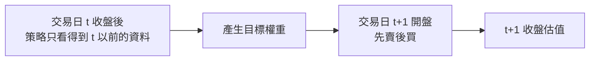

# 台股智慧量化投資決策系統｜回測框架（Phase 1）

- 文件版本：0.1
- 日期：2026-11-19
- 對應：系統規格書 §4「策略與模型驗證標準」；產品企劃書 Phase 1「建立交易成本及成交模擬」「建立基準策略與回測框架」
- 程式：`backend/src/apex/backtest/`

---

## 1. 時間順序（防止前視偏誤）



- **訊號與成交分開**：t 日收盤後產生的訊號，在 t+1 日以開盤價成交。
- 策略透過 `Context.history()` 取資料，只回傳到訊號日（含）為止。
- 月營收、財報透過 `PointInTime` 查詢，只回傳**可取得日 ≤ 查詢日**的資料（見資料層設計 §12）。
- 持股以還原價計算市值，等於現金股利自動再投入；手續費、整張、成交量上限以未還原價格計算。
- **每日出場檢查**（2026-11-21）：策略可以從 `Context.weights` 看到訊號日收盤後實際持有的權重（用來判斷停損）。
  `run(..., min_trade=)` 設定時，目標權重和現有權重差距小於總資產這個比例就不交易（全部賣出不受限），
  避免每天檢查的策略為了權重漂移來回買賣。見《研究報告/出場規則研究.md》。

## 2. 交易成本與成交模擬（`CostModel`）

| 項目 | 預設 | 說明 |
|---|---|---|
| 手續費 | 0.1425% × 折扣，最低 1 元 | 最低 1 元依你的券商；折扣尚未提供，預設 1（無折扣） |
| 證交稅（賣出） | 股票 0.3%、ETF 0.1%、債券 ETF 0% | 債券 ETF 停徵至 2026-12-31 |
| 滑價 | 每邊 10 bp | 買進加價、賣出減價 |
| 交易單位 | 1 股（允許零股） | 你會買零股；改為 1000 即只能整張 |
| 成交量上限 | 當日成交金額的 10% | 超過的部分不成交 |
| 漲跌停 | 開盤相對前一日收盤（還原）漲跌 ≥ 9.5% | 漲停買不到、跌停賣不掉，委託取消 |
| 無成交 | — | 當日沒有成交（停止買賣）時買賣都不執行 |
| 下市 | 最後收盤價 × 100% | 最後交易日到終止日之間持股凍結；終止日轉為現金 |

**規格書 §8 第 7 項**：最低手續費 1 元、會買零股（2026-11-19 確認）。**手續費折扣尚未提供**，暫用法定上限（無折扣），比實際成本保守；可用 `--discount 0.28` 覆寫。

**下市回收比例**：合併換股（例如 2888 新光金併入台新金）通常接近 100%；經營不善下市可能遠低於此。預設 100% 會高估下市股的結果，敏感度可用 `--delist-recovery 0` 檢查。

## 3. 下市與停止買賣

資料層 §10 發現 28 檔股票在終止前停止買賣超過 30 天，例如 3662 樂陞停止交易將近一年。回測處理：

1. 最後交易日之後沒有成交：持股以最後收盤價估值，**賣單無法執行**（事件紀錄中可見）。
2. 到終止上市（櫃）日：依 `delist_recovery` 轉為現金。
3. 不在一覽表也沒有終止紀錄的（ETF 清算、ETN 到期）：最後交易日後的第一天轉為現金。

## 4. 績效指標（`metrics.summarize`）

| 指標 | 說明 |
|---|---|
| `total_return`、`cagr` | 累積、年化報酬 |
| `volatility`、`sharpe`、`sortino` | 年化，每年 245 個交易日 |
| `max_drawdown`、`max_drawdown_days`、`calmar` | 最大回撤、最長水下天數 |
| `benchmark_cagr`、`excess_cagr`、`information_ratio` | 相對加權報酬指數 |
| `exposure` | 平均持股比例（資金使用率） |
| `n_trades`、`win_rate`、`profit_factor`、`avg_win_loss`、`avg_holding_days` | 以每筆賣出計算損益（含成本） |
| `turnover`、`total_costs`、`cost_drag` | 年週轉率、總成本、成本占平均資產的年化比例 |

另有 `yearly_returns` 逐年報酬與超額報酬。

## 5. 基準（規格書 §4「基準比較」）

| 基準 | 指令 | 用途 |
|---|---|---|
| 加權報酬指數（含息） | 自動比較 | 市場基準。不用一般加權指數，因為它不含股利，會低估市場約每年 3～4% |
| 買進持有 0050 | `--strategy buyhold:0050 --freq once` | 最簡單、成本最低的替代方案 |
| 流動性前 50 大等權重 | `--strategy equal:50` | 「不選股、只分散」 |
| 12-1 動能前 20 名 | `--strategy momentum:20` | 簡單量化基準 |

可投資範圍（`liquid_universe`）：普通股，近 20 日平均成交金額 ≥ 5,000 萬、收盤價 ≥ 10 元、已交易 60 天以上。

## 6. 指令

```bash
python -m apex backtest --strategy buyhold:0050 --start 2016-01-04 --end 2026-11-17 --freq once
python -m apex backtest --strategy momentum:20 --start 2016-01-04 --end 2026-11-17 --capital 1000000 \
    --discount 0.28 --min-fee 1 --lot 1
```

## 7. 基準結果（2026-11-19）

期間 2016-01-04～2026-11-17，本金 100 萬，成本為法定手續費無折扣、最低 20 元、滑價 10 bp、允許零股（最低手續費改為 1 元前所跑；本金 100 萬時單筆手續費幾乎都超過 20 元，影響可忽略）。市場基準：加權報酬指數年化 **19.94%**。

| 基準 | 年化報酬 | 波動度 | Sharpe | 最大回撤 | 年週轉 | 成本拖累 | 相對報酬指數 |
|---|---|---|---|---|---|---|---|
| 買進持有 0050 | 22.03% | 20.0% | 1.10 | −33.9% | 0.02 | 0.00% | +2.09% |
| 流動性前 50 大等權重（月） | 19.98% | 28.6% | 0.79 | −44.1% | 1.99 | 1.46% | +0.04% |
| 12-1 動能前 20 名（月） | 11.21% | 34.9% | 0.48 | −50.8% | 4.64 | 2.78% | −8.73% |

- **0050 逐年報酬與實際含息報酬相符**（2019 +33.5%、2022 −21.4%、2024 +48.6%）：資料、還原股價與引擎的時間順序一致。
- 0050 小幅勝過報酬指數，是因為這段期間大型股（台積電）表現優於全市場。
- 等權重的成本約每年 1.5%：手續費折扣 2.8 折、滑價 5 bp 時年化提高到 20.53%，成本拖累降為 1.16%。**券商折扣對高週轉策略影響明顯**。
- 動能策略在 2025～2026 年大幅落後，週轉率高、成本拖累近 3%。簡單動能在這段期間並不有效，之後的策略至少要勝過 0050 與等權重。
- 下市處理有實際作用：等權重持有的 3474 華亞科 2016-11-29 停止交易、12-06 下市轉現金；2311 日月光 2018-04-30 轉為日月光投控時轉現金。
- 全期回測約 12 秒（0050）～2 分鐘（每月選股）。

**目前的門檻**：Phase 2 的策略要在成本後同時勝過**加權報酬指數**與**買進持有 0050**，並在不同年份表現穩定，才值得保留。

## 8. 已知限制

- 漲跌停以開盤漲跌幅近似判斷，未考慮新上市前 5 日無漲跌幅限制，也未處理處置股的分盤交易。
- 零股在 2020-10-26 以前只能盤後交易，回測仍以開盤價成交，零股的成交假設在早期偏樂觀。
- 還原股價的股利再投入發生在除息日，實際股利約 1 個月後才入帳。
- 尚未支援融資融券、當沖、放空。
