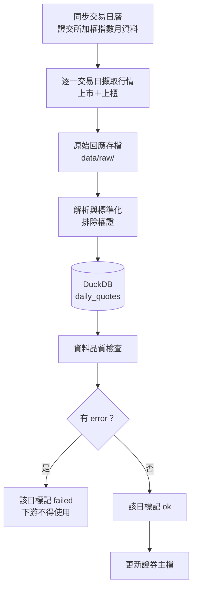

# 台股智慧量化投資決策系統｜資料層設計（Phase 1）

- 文件版本：0.3
- 日期：2026-11-18
- 對應：系統規格書 STEP 01、STEP 02；產品企劃書 Phase 1
- 範圍：交易日曆、日行情、證券主檔、資料品質檢查、公司行動與還原股價（§9）、產業別與下市櫃（§10）、籌碼（§11）、月營收與財報（§12）、指數與休市日（§13）。回測見《回測框架.md》。

---

## 1. 流程



## 2. 資料來源與規則

| 資料 | 來源端點 | 頻率 |
|---|---|---|
| 交易日曆 | 證交所 `rwd/zh/TAIEX/MI_5MINS_HIST?date=YYYYMM01` | 每月一次；當月需重抓 |
| 上市日行情 | 證交所 `rwd/zh/afterTrading/MI_INDEX?type=ALLBUT0999` | 每交易日一次 |
| 上櫃日行情 | 櫃買中心 `www/zh-tw/afterTrading/dailyQuotes` | 每交易日一次，含「管理股票」表 |
| 公司行動 | 見 §9 | 每年一次整批；當年需重抓 |
| 產業別、下市櫃 | 見 §10 | 一覽表每月一份；終止上市每天、終止上櫃逐年 |
| 三大法人、融資融券 | 見 §11 | 每交易日一次 |
| 月營收、財報 | 見 §12 | 每月、每季；公告期限後 30 天內每次重抓 |
| 指數、休市日 | 見 §13 | 每月；休市日每次更新今明兩年 |

- **交易日的定義**：加權指數月資料中有出現的日期。上櫃與上市使用同一份交易日曆。
- **原始回應全部保存**：`data/raw/<來源>/<年>/<日期>.json`。已有原始檔就不重抓，解析程式修正後可直接重新解析。
- **請求限速**：同一主機每次請求間隔 3 秒；失敗時退避重試 3 次。
- **未發布 vs 假日**：交易日當天若證交所回「沒有符合條件的資料」、或櫃買中心回空表，視為「尚未發布」，記錄為 failed，之後重試。不會當作 0 筆資料寫入。

## 3. 證券分類

依代號規則分類，**權證與牛熊證不入庫**：

| 類別 | 代號規則 | 例 |
|---|---|---|
| `stock` 普通股 | `^[1-9]\d{3}$` | 2330 |
| `etf` ETF | `^00\d{2,4}[A-Z]?$` | 0050、00400A |
| `preferred` 特別股 | `^[1-9]\d{3}[A-Z]\d?$` | 2881A、2887Z1 |
| `dr` 存託憑證 | `^91(\d{2}\|\d{4})$` | 910322、9103（早期 4 碼） |
| `etn` ETN | `^02\d{3,4}[A-Z]?$` | 020000、02001L |
| `reit` 受益證券 | `^01\d{3}T$` | 01001T |
| （排除）權證 | `^(0[3-8]\d{4}\|7\d{4,5})[A-Z]?$` | 712108、71425P |
| `other` 其他 | 其餘 | 保留並在品質檢查中列出 |

## 4. 資料表（DuckDB：`data/apex.duckdb`）

| 表 | 主鍵 | 內容 |
|---|---|---|
| `trading_days` | `date` | 交易日、來源、擷取時間 |
| `calendar_months` | `month` | 已同步的月份、交易日數 |
| `daily_quotes` | `date, market, code` | 名稱、類別、開高低收、成交股數、成交金額、成交筆數、是否管理股票、擷取時間 |
| `ingest_status` | `date, market` | ok／failed、筆數、訊息、原始檔雜湊、時間 |
| `dq_results` | `date, check_name, market` | 品質檢查結果：severity（info／warning／error）、說明 |
| `securities` | `code` | 最新名稱、市場、類別、首次／最後出現日、出現天數；掛牌狀態、終止日、產業別、上市櫃日（§10） |
| `listing_snapshots` | `month, code` | 每月一份 ISIN 一覽表：市場別、分段、產業別、上市櫃日 |
| `delistings` | `date, market, code` | 終止上市、終止上櫃紀錄（上櫃含原因） |
| `corporate_actions` | `date, market, code, kind` | 除權息、減資、變更面額、ETF 分割：事件前收盤、參考價、理論參考價 |
| `action_sync` | `source, year` | 公司行動與終止上櫃已同步的年度 |
| `adj_factors` | `code, date` | 每個事件的還原因子與累積因子 |
| `daily_quotes_adj`（view） | | 日行情加上 `adj_factor`、`adj_open`～`adj_close` |
| `institutional` | `date, market, code` | 三大法人買賣超（股） |
| `margin` | `date, market, code` | 融資融券（張） |
| `dataset_status` | `dataset, date, market` | 籌碼資料的 ok／failed |
| `monthly_revenue` | `year, month, code` | 月營收（元）、當時產業別、可取得日 |
| `fin_income`、`fin_balance` | `year, quarter, code` | 綜合損益（年初累計）、資產負債 |
| `financials`、`financials_q`（view） | | 合併兩表並附可取得日；`_q` 為單季損益 |
| `period_sync` | `source, period` | 月營收、財報已同步的期間 |
| `index_daily` | `date, index_code` | 加權指數（TAIEX）、加權報酬指數（TAIEX_TR） |
| `market_holidays` | `date` | 證交所公布的開休市日期（含明年） |

- 價格為**未還原**的原始成交價。沒有成交時開高低收為 NULL。
- 成交股數單位為「股」，成交金額為「元」。
- `ingest_status` 為 ok 才代表該日該市場資料可供下游使用。

## 5. 資料品質檢查

| 檢查 | 嚴重度 | 規則 |
|---|---|---|
| `row_count` | error | 筆數低於前 20 個交易日中位數的 80% |
| `empty_market` | error | 交易日該市場 0 筆 |
| `cross_market_duplicate` | error | 同一代號同日同時出現在上市與上櫃 |
| `ohlc_consistency` | 超過 1% 為 error，否則 warning | 最低價 ≤ 開盤、收盤 ≤ 最高價，且價格 > 0 |
| `no_trade_ratio` | warning | 普通股無成交比例 > 30% |
| `extreme_move` | warning | 普通股收盤相對前一交易日收盤漲跌超過 10.5%。有公司行動時以參考價為基準；新上市櫃前 5 日不檢查 |
| `unknown_type` | warning | 出現無法分類的代號 |

`extreme_move` 已排除除權息、減資、變更面額與新上市櫃。10 年資料目前 0 筆警告，之後出現的警告都值得檢查（可能是缺漏的公司行動）。

## 6. 指令

```bash
python -m apex calendar --start 2015-01 --end 2026-11   # 同步交易日曆
python -m apex ingest --date 2026-11-13                 # 擷取單日
python -m apex backfill --start 2015-01-01 --end 2026-11-13   # 回補（可中斷續跑）
python -m apex backfill --start ... --end ... --reprocess     # 規則修改後，用已存原始檔重新解析
python -m apex actions --start-year 2015 --end-year 2026  # 同步公司行動並重建還原因子（--reprocess 重新解析）
python -m apex listings                                  # 同步產業別、上市櫃日、終止上市櫃清單
python -m apex chips --start 2015-01-01 --end 2026-11-17   # 三大法人、融資融券（可中斷續跑）
python -m apex fundamentals --start-year 2015            # 月營收、季財報
python -m apex indices --start 2015-01 --end 2026-11     # 加權指數、加權報酬指數
python -m apex holidays                                  # 今明兩年開休市日期
python -m apex recheck --start 2015-01-01 --end 2026-11-17  # 只重跑品質檢查
python -m apex update                                    # 每日更新：上述全部（近一個月）
python -m apex status                                    # 資料狀態摘要
```

## 7. 實測結果（2026-11-18）

- 回補 2026-10-01～2026-11-17 共 31 個交易日，上市、上櫃全部 ok。每日約上市 1,390 筆、上櫃 1,020 筆（已排除權證）。
- 證券主檔：普通股 1,988、ETF 366、特別股 28、ETN 21、存託憑證 6、受益證券 6。
- 台積電 2026-11-13 收盤 2,350、成交 30,973,127 股，與 FinMind 一致。
- 品質警告：3 檔普通股單日跌幅超過 10.5%，推測為除權息或減資，待還原股價完成後確認。
- 效能：每個交易日約 6 秒，主要是網路與限速間隔；從原始檔重新處理一天約 1 秒。**10 年完整回補預估 4～5 小時**。
- 寫入改用 DataFrame 整批寫入：DuckDB 的 executemany 逐筆執行，2,400 筆約需 6 秒，改寫後約 0.05 秒。

### 10 年回補（2026-11-18）

- 範圍 2015-01-05～2026-11-17，共 2,892 個交易日，上市、上櫃全部 ok，0 失敗。實際耗時約 2.5 小時（每日約 3 秒，兩個主機的限速間隔可重疊）。
- 共 5,727,752 筆日行情、2,688 個代號：普通股 2,143、ETF 432、ETN 48、特別股 38、存託憑證 19、受益證券 8（含已下市櫃）。之後修正 4 碼存託憑證分類，普通股為 2,136、存託憑證 26（§10）。
- 每日筆數：上市 909～1,391、上櫃 684～1,022，逐年增加。
- 資料量：DuckDB 544 MB，原始檔 3.5 GB。
- 發現並修正：櫃買 2015-11-23 的回應在資料列中混入表頭列（「104年11月23日 櫃檯買賣中心證券行情」），被當成一個代號。解析時改為略過代號不是英數字的列，以原始檔重新處理該日。
- `extreme_move` 警告共 821 天（每年 51～91 天），多為單一個股。公司行動納入後全部有解釋，見 §9。

## 8. 尚未涵蓋（Phase 1 後續）

1. ~~除權息與還原股價~~（§9）。
2. ~~下市櫃清單與證券主檔整合~~（§10）。
3. ~~產業分類~~（§10，已下市櫃者缺產業別）。
4. ~~三大法人、融資融券~~（§11）。
5. ~~月營收、財報~~（§12）。
6. ~~未來交易日~~（§13）。

Phase 1 資料項目已全部完成。

## 9. 公司行動與還原股價

### 來源

全部以年度區間查詢，12 年只需約 108 次請求（約 6 分鐘）。

| 事件 | 上市（證交所 `rwd/zh/…`） | 上櫃（櫃買中心 `www/zh-tw/bulletin/…`） | 10 年筆數 |
|---|---|---|---|
| 除權息 | `exRight/TWT49U` | `exDailyQ` | 22,348 |
| 減資 | `reducation/TWTAUU` | `revivt` | 567 |
| 變更面額 | `change/TWTB8U` | `pvChgRslt` | 24 |
| ETF 分割／反分割 | `split/TWTCAU` | `etfSplitRslt`、`etfRvsRslt` | 12（目前全為上市） |

### 計算

- 每個事件的因子＝**參考價 ÷ 事件前收盤價**。四種事件一致處理，不需要自行從股利金額推算。
- **向後還原**：最新價格不變，事件生效日之前的價格乘上之後所有事件因子的乘積（`adj_factors.cum_factor`，以 ASOF join 套用）。
- 事件日遇休市（如 2026-07-10 颱風）時，以之後第一個交易日為生效日。
- 尚未發生的事件（日期晚於最新行情）不影響目前價格。
- 還原以**代號**串接，不分市場，所以上櫃轉上市的股票歷史連續。
- 成交量未還原。

### 現金增資：只扣股利，不扣認股權

除權息資料有兩個參考價：

- **除權息參考價**：含現金增資認股權的理論價值。
- **減除股利參考價**：只扣現金與股票股利。

交易所在現增除權日放寬漲跌幅：漲停以減除股利參考價計算，跌停以除權息參考價計算，價格可落在兩者之間。例：6225 於 2026-08-18 除權息參考價 30.04，漲停 48.80＝44.40×1.1，跌停 27.05＝30.04×0.9，當日收漲停 48.80。

**還原採用減除股利參考價**。現增需另外繳款認購，股利則自動入帳；回測假設不參與認購，報酬才與實際持有一致。理論參考價另存 `theo_ref`，只用於品質檢查的合理區間。

### 使用注意

- 策略計算報酬、均線、波動度等用 `adj_*`；判斷漲跌停、價格門檻（例如股價低於 10 元）、成交金額用**未還原**價格。
- 向後還原的歷史價格會隨新事件改變，只有報酬率不變。回測不可把還原後的歷史「價格水準」當成當時可見的資訊。

### 驗證（2026-11-18）

- 普通股 `extreme_move` 警告由 821 天降為 0：
  - 公司行動解釋了約 680 天。
  - 其餘 143 筆全是新上市櫃前 5 日（不設漲跌幅）。
- 過程中發現並修正三個問題：
  1. 原本用除權息參考價，現增除權日出現假的大漲（6225 +62%）。
  2. 颱風休市日的事件沒有對到交易日（3034、5519 等）。
  3. ETF 分割不在除權息資料中，0050 2025-06-18 一拆四原本顯示 -75%。
- 0050 分割前後還原價連續：2025-06-10 45.90、2025-06-18 46.30。
- 非普通股的大幅變動已逐一檢查，屬實際行情：
  - 槓桿與反向 ETF：2020-03、2025-04 等。
  - 00887：2024-10 溢價。
  - 00738U：2026-02。
- 全市場 573 萬筆還原行情查詢約 0.4 秒。
- 尚未與第三方還原股價交叉驗證（FinMind Backer 需付費，待決定）。

## 10. 產業別與下市櫃

### 來源

| 資料 | 端點 | 內容 |
|---|---|---|
| ISIN 一覽表 | `isin.twse.com.tw/isin/C_public.jsp?strMode=2`（上市）、`4`（上櫃） | 目前掛牌的全部證券：分段（股票、ETF…）、市場別（含創新板）、產業別、上市櫃日。MS950 編碼 |
| 終止上市 | 證交所 `rwd/zh/company/suspendListing` | 2001 年至今全部，一次回傳 |
| 終止上櫃 | 櫃買中心 `www/zh-tw/company/deListed?date=YYYY` | 逐年查詢，含原因（法規條文） |

- 一覽表只有**目前**掛牌的證券，每月保存一份（上市含權證約 10 MB）。產業別的歷史變動從現在開始累積。
- 終止上櫃也包含上櫃轉上市（例如 1795 美時 2019-12-16），所以「終止上櫃」不等於下市。

### 證券主檔的掛牌狀態

| status | 規則 | 數量（2026-11-18） |
|---|---|---|
| `listed` | 在最新一覽表中，包含停止買賣但尚未終止者（如 4804 大略-KY 自 2026-04 起無成交） | 2,416 |
| `delisted` | 最後交易日之後，在同一市場有終止紀錄；`delisted_date` 為終止日 | 158 |
| `ended` | 不在一覽表也沒有終止紀錄：ETF 清算、ETN 到期，以及 8 檔 2015～2020 年的上櫃股 | 114 |

- 一覽表可能晚一兩天才移除下市的證券（1589 永冠-KY 終止上市當天仍在表上），所以終止紀錄優先。
- 判斷轉市場時，以一覽表目前的市場別為準，避免把上櫃轉上市當成下市。
- 同一代號可能被重複使用，早於首次交易的終止紀錄不會被採用。

### 驗證（2026-11-18）

- 10 年內停止交易的普通股：上市 70 檔中 69 檔有終止紀錄（另 1 檔為停止買賣、尚未終止）；上櫃 111 檔中 100 檔有紀錄或已轉上市。8 檔上櫃股查無終止紀錄，標記為 `ended`。
- 158 檔下市中有 28 檔「最後交易日」比「終止日」早 30 天以上，也就是下市前長期停止買賣（例：3662 樂陞 2016-11 停止交易，2017-10 才終止）。**回測持有這類股票時，資金會在停止買賣期間被卡住**，回測框架需要處理。
- 目前掛牌的普通股 1,986 檔全部有產業別，共 34 個產業。
- 一覽表的分段與本系統的代號分類全部一致。比對時發現 7 檔早期存託憑證使用 4 碼代號（9103 美德醫療-DR 等），原本被歸為普通股，已修正分類規則，並直接更新既有行情的類別（類別只由代號決定，不需要重新解析）。

### 限制

- 已下市櫃的普通股原本沒有產業別，已依序以「最後一次月營收公告的產業別」、FinMind 公司資料（名稱對應到證交所產業名稱）補齊：150 檔中 103 檔有產業別，其餘 47 檔多為 2015～2019 年下市的小型公司，免費來源都查不到（§12）。
- 目前的產業別套用到全部歷史。證交所 2023 年新增數位雲端、綠能環保等產業，部分公司在那之前屬於其他產業，回測若依產業分組，早期會有些微的前視偏差。


## 11. 籌碼：三大法人、融資融券

| 資料 | 上市 | 上櫃 | 單位 |
|---|---|---|---|
| 三大法人買賣超 | 證交所 `rwd/zh/fund/T86?selectType=ALLBUT0999` | 櫃買中心 `www/zh-tw/insti/dailyTrade?type=Daily&sect=EW` | 股 |
| 融資融券 | 證交所 `rwd/zh/marginTrading/MI_MARGN?selectType=ALL` | 櫃買中心 `www/zh-tw/margin/balance` | 張 |

- **外資一律為「外資及陸資合計」（含外資自營商）**。證交所 2017-12-18 起才把外資自營商分開列示，合計後新舊格式一致；分開的數字另存 `foreign_dealer_net`（舊格式為 NULL）。
- 櫃買新格式（24 欄）的欄名重複（都叫「買進股數」），依網頁表頭分組順序解析：外資（不含外資自營商）、外資自營商、外資合計、投信、自營商（自行買賣）、自營商（避險）、自營商合計、三大法人合計。
- 解析時檢查：外資＋投信＋自營商＝三大法人合計、自營商自行＋避險＝自營商合計，樣本全部相符。
- 只擷取日行情為 ok 的交易日；當日 0 筆視為尚未發布，之後重試。狀態記在 `dataset_status`。

**驗證結果（2026-11-19）**：2015-01-05～2026-11-17 共 2,892 個交易日。

| 項目 | 結果 |
|---|---|
| 狀態 | 三大法人、融資融券 × 上市、上櫃共 11,568 個市場×資料集×日，全部 ok，0 失敗、0 缺漏 |
| 筆數 | 三大法人 4,903,584 筆；融資融券 5,187,993 筆 |
| 加總一致 | 外資＋投信＋自營商＝合計、外資買－賣＝買賣超、自營自行＋避險＝自營合計：全部相符 |
| 涵蓋率（有成交普通股） | 三大法人 78%（2015）→ 95%（2026）；融資融券約 92% |

- 三大法人未達 100%：交易所只列出當日有法人買賣的股票，沒出現代表三家法人皆未交易（買賣超為 0）。
- 融資融券未達 100%：不是信用交易標的的股票（例如新上市、全額交割股）不會列出。
- 筆數偏低的日子是週六補行交易日。

## 12. 月營收與財報

| 資料 | 來源 | 可取得日（`available_date`） |
|---|---|---|
| 月營收 | 公開資訊觀測站 `nas/t21/{sii,otc}/t21sc03_{民國年}_{月}_{0,1}.html`（0 國內、1 外國公司） | 次月 11 日（法定期限 10 日的次日） |
| 綜合損益表 | 觀測站 `mops/web/ajax_t163sb04`（POST） | 一般業：Q1 5/16、Q2 8/15、Q3 11/15；年報 次年 4/1 |
| 資產負債表 | 觀測站 `mops/web/ajax_t163sb05`（POST） | 金融、保險、證券等格式：Q1 5/31、Q2 9/1、Q3 11/30；年報 次年 4/1 |
| 已下市櫃公司 | FinMind 免費 API（`TaiwanStockMonthRevenue`、`TaiwanStockFinancialStatements`、`TaiwanStockBalanceSheet`） | 同上 |

- **回測只能使用 `available_date ≤ 訊號日` 的資料**（`backtest.PointInTime`）。多數公司提早公告，用法定期限是保守做法。
- 金額單位統一為元（觀測站為千元，已換算）；EPS、每股淨值為元。
- 損益表為**年初至今累計**，與觀測站一致；`financials_q` 以「本季累計 − 同年前一季累計」算出單季數字，前一季缺漏時為 NULL。
- 觀測站的財報彙總依產業分成多種格式（一般業、銀行、證券、金控、保險、其他），已將主要項目對應到統一欄位：營收（銀行為淨收益）、毛利、營業利益、稅前淨利、本期淨利、歸屬母公司淨利、EPS、流動資產、總資產、流動負債、總負債、股本、歸屬母公司權益、權益、每股淨值。
- 資料為觀測站目前的版本；公司事後更正時看到的是更正後數字（極少見）。
- 公告期限後 30 天內的期間每次更新都重抓，以納入延遲申報與更正。

### 倖存者偏差：觀測站彙總表只有目前上市櫃的公司

驗證時發現，觀測站的月營收與財報彙總表會重新產生（2015 年的頁面「出表日期」為 2026-11），**只包含目前仍上市櫃的公司**：

| 月份 | 當時有交易的普通股 | 之後下市櫃者 | 觀測站有營收的下市櫃者 |
|---|---|---|---|
| 2015-01 | 1,540 | 131 | 1 |
| 2019-06 | 1,705 | 83 | 1 |
| 2024-01 | 1,814 | 25 | 0 |

只用觀測站會讓回測只看到「活下來的公司」，基本面策略的結果會被高估。因此已下市櫃的普通股改由 FinMind 免費 API 逐檔補齊（約 150 檔 × 3 個資料集）：

- FinMind 的損益為單季數字，先轉成年初累計再寫入，與觀測站同一套欄位與檢視表。台積電 2025 H1 換算後營收 1.773 兆、EPS 29.31，與觀測站相同。
- 觀測站已有的資料優先，FinMind 只補缺漏（`source = 'finmind'`）。
- 未登入的免費額度約每小時 300 次，請求間隔 13 秒；額度用完時停止，下次續跑（`python -m apex finmind`）。

### 驗證（2026-11-19）

- 觀測站：月營收 254,933 筆（2015-01～2026-10）、財報 47 季（2015Q1～2026Q3），沒有尚未公告的期間。下載約 1 小時。
- 台積電：
  - 年度 EPS 2015 11.82、2020 19.97、2024 45.25，與公告相符。
  - 2025 年 12 個月營收合計 3.809 兆，等於年報營收。
  - 2026 Q3 單季 EPS 29.42（由累計數相減）。
- 第 1、3 季的公司數比第 2、4 季少約 150 家（2015 年），逐年縮小到 2026 年約 10 家：早期部分外國公司（-KY）只需申報半年報與年報。
- FinMind 補齊：已下市櫃普通股 150 檔，補入月營收 7,557 筆（87 檔）、損益 3,273 筆、資產負債 3,280 筆。約 1.5 小時，未用完免費額度。

| 有交易的普通股 | 月營收覆蓋（股×月） | 財報覆蓋（股×季） |
|---|---|---|
| 目前上市櫃 | 100.0% | 100.0% |
| 已下市櫃（補齊前） | 約 1% | 約 0% |
| 已下市櫃（補齊後） | 78.5% | 94.7% |

**殘餘缺口**：約 60 檔 2015～2019 年下市的公司（如 2311 日月光、2325 矽品、2475 華映）FinMind 也沒有月營收，但都有季財報。月營收策略在 2015～2019 年仍有輕微倖存者偏差；需要時可改用季營收（`financials_q.revenue`）。網路封存（Wayback Machine）也沒有觀測站舊頁面。

## 13. 市場指數與休市日

| 資料 | 來源 | 用途 |
|---|---|---|
| 加權指數（開高低收） | 交易日曆的原始檔（`MI_5MINS_HIST`） | 市場狀態判斷 |
| 發行量加權股價報酬指數 | 證交所 `rwd/zh/TAIEX/MFI94U` | **回測的市場基準**（含息） |
| 開休市日期 | 證交所 `rwd/zh/holidaySchedule/holidaySchedule?date=YYYY0101` | 推估未來交易日 |

- 休市表也列出「開始交易日」「最後交易日」等仍有交易的日子，名稱含「交易日」者視為開市；「市場無交易，僅辦理結算交割作業」為休市。
- `Database.expected_trading_days()`：已知日期用實際交易日，之後以「平日且非公布休市日」推估。颱風等臨時休市無法預知，排程應以當天實際行情為準。
- 明年的休市表通常在年中後公布，未公布時略過。

### 驗證（2026-11-19）

- 加權指數、加權報酬指數各 2,893 個交易日（2015-01-05～2026-11-18），與交易日曆完全一致。加權指數 9,274 → 40,195；報酬指數 14,122 → 92,953。
- 休市日：2026 年 27 筆（休市 24 天）、2027 年 29 筆（休市 26 天）。下一個休市日為 2026-12-25 行憲紀念日。
