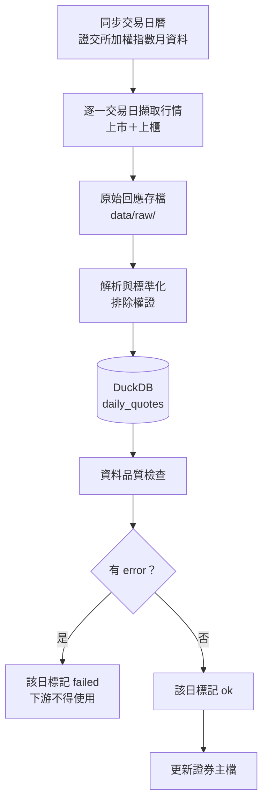

# 台股智慧量化投資決策系統｜資料層設計（Phase 1）

- 文件版本：0.1
- 日期：2026-11-15
- 對應：系統規格書 STEP 01、STEP 02；產品企劃書 Phase 1
- 範圍：交易日曆、日行情、證券主檔、資料品質檢查。還原股價、法人、融資融券、財報、月營收在後續步驟加入。

---

## 1. 流程



## 2. 資料來源與規則

| 資料 | 來源端點 | 頻率 |
|---|---|---|
| 交易日曆 | 證交所 `rwd/zh/TAIEX/MI_5MINS_HIST?date=YYYYMM01` | 每月一次；當月需重抓 |
| 上市日行情 | 證交所 `rwd/zh/afterTrading/MI_INDEX?type=ALLBUT0999` | 每交易日一次 |
| 上櫃日行情 | 櫃買中心 `www/zh-tw/afterTrading/dailyQuotes` | 每交易日一次，含「管理股票」表 |

- **交易日的定義**：加權指數月資料中有出現的日期。上櫃與上市使用同一份交易日曆。
- **原始回應全部保存**：`data/raw/<來源>/<年>/<日期>.json`。已有原始檔就不重抓，解析程式修正後可直接重新解析。
- **請求限速**：同一主機每次請求間隔 3 秒；失敗時退避重試 3 次。
- **未發布 vs 假日**：交易日當天若證交所回「沒有符合條件的資料」、或櫃買中心回空表，視為「尚未發布」，記錄為 failed，之後重試。不會當作 0 筆資料寫入。

## 3. 證券分類

依代號規則分類，**權證與牛熊證不入庫**：

| 類別 | 代號規則 | 例 |
|---|---|---|
| `stock` 普通股 | `^[1-9]\d{3}$` | 2330 |
| `etf` ETF | `^00\d{2,4}[A-Z]?$` | 0050、00400A |
| `preferred` 特別股 | `^[1-9]\d{3}[A-Z]\d?$` | 2881A、2887Z1 |
| `dr` 存託憑證 | `^91\d{4}$` | 910322 |
| `etn` ETN | `^02\d{4}[A-Z]?$` | 020000 |
| `reit` 受益證券 | `^01\d{3}T$` | 01001T |
| （排除）權證 | `^(0[3-8]\d{4}\|7\d{4,5})[A-Z]?$` | 712108、71425P |
| `other` 其他 | 其餘 | 保留並在品質檢查中列出 |

## 4. 資料表（DuckDB：`data/apex.duckdb`）

| 表 | 主鍵 | 內容 |
|---|---|---|
| `trading_days` | `date` | 交易日、來源、擷取時間 |
| `calendar_months` | `month` | 已同步的月份、交易日數 |
| `daily_quotes` | `date, market, code` | 名稱、類別、開高低收、成交股數、成交金額、成交筆數、是否管理股票、擷取時間 |
| `ingest_status` | `date, market` | ok／failed、筆數、訊息、原始檔雜湊、時間 |
| `dq_results` | `date, check_name, market` | 品質檢查結果：severity（info／warning／error）、說明 |
| `securities` | `code` | 最新名稱、市場、類別、首次／最後出現日、出現天數 |

- 價格為**未還原**的原始成交價。沒有成交時開高低收為 NULL。
- 成交股數單位為「股」，成交金額為「元」。
- `ingest_status` 為 ok 才代表該日該市場資料可供下游使用。

## 5. 資料品質檢查

| 檢查 | 嚴重度 | 規則 |
|---|---|---|
| `row_count` | error | 筆數低於前 20 個交易日中位數的 80% |
| `empty_market` | error | 交易日該市場 0 筆 |
| `cross_market_duplicate` | error | 同一代號同日同時出現在上市與上櫃 |
| `ohlc_consistency` | 超過 1% 為 error，否則 warning | 最低價 ≤ 開盤、收盤 ≤ 最高價，且價格 > 0 |
| `no_trade_ratio` | warning | 普通股無成交比例 > 30% |
| `extreme_move` | warning | 普通股收盤相對前一交易日收盤漲跌超過 10.5% |
| `unknown_type` | warning | 出現無法分類的代號 |

`extreme_move` 只是提醒：除權息、新股上市前 5 日不設漲跌幅，以及 2015-06-01 前漲跌幅為 7%，都可能造成合理的大幅變動。還原股價完成後再加強這項檢查。

## 6. 指令

```bash
python -m apex calendar --start 2015-01 --end 2026-11   # 同步交易日曆
python -m apex ingest --date 2026-11-13                 # 擷取單日
python -m apex backfill --start 2015-01-01 --end 2026-11-13   # 回補（可中斷續跑）
python -m apex update                                    # 每日更新：同步當月日曆＋補齊缺漏日
python -m apex status                                    # 資料狀態摘要
```

## 7. 尚未涵蓋（Phase 1 後續）

1. 除權息與還原股價。
2. 下市櫃清單（FinMind `TaiwanStockDelisting`、證交所終止上市）與證券主檔整合。
3. 產業分類。
4. 三大法人、融資融券。
5. 月營收、財報（以法定申報期限為可取得日）。
6. 未來交易日（假日表），供第 5 階段排程使用。
